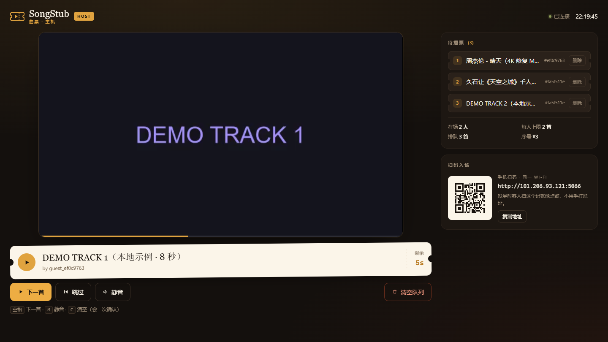
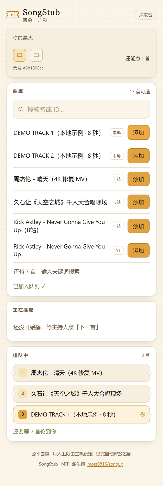
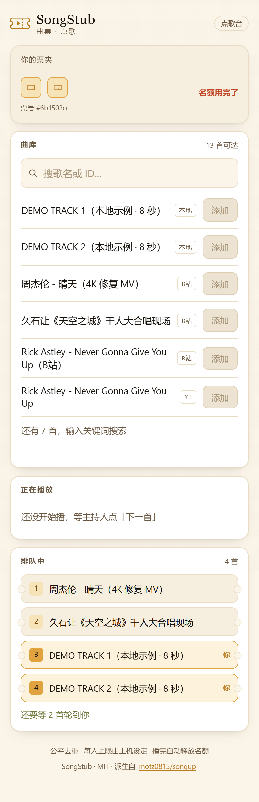
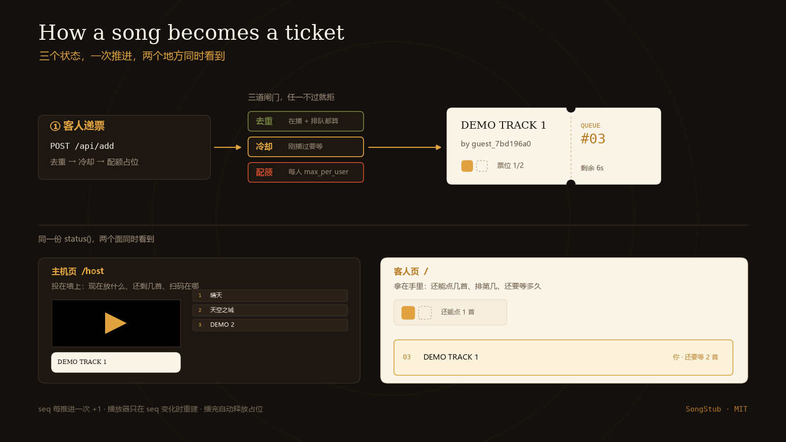

# SongStub · 曲票

聚会点歌队列 —— 公平去重 + 真能播出来的播放器。

思路来自 [motz0815/songup](https://github.com/motz0815/songup)：客人扫码点歌，主机的屏幕负责放。
这个版本重写了原 `optimized-songup-queue` 的引擎与前端，**把上一版宣称但没做的那件事补上了：播放器**。

> **v2.1 视觉与交互改版**：产品名从 SongUp Queue 改为 **SongStub / 曲票**，界面按「一张票」的
> 隐喻重做。设计与验收口径见 [`docs/design/DESIGN.md`](docs/design/DESIGN.md)。
> 仓库名仍为 `songup-queue`，不破坏已有链接。

<p align="center">
  
</p>

<p align="center">
  
  &nbsp;&nbsp;
  
</p>

> 截图里的播放画面是仓库自带的 8 秒测试片（ffmpeg 生成的纯色帧），不含任何第三方素材。
> 全部截图由 [`verify/docs-shot.cjs`](verify/docs-shot.cjs) 通过真实 API 造状态后拍摄，
> 不是手摆的静态页。

## 为什么叫「曲票」

这个产品只有两个动作：**客人递一张票**，**主机撕一张票**。

代码里被反复修正的东西也全是票据规则——每人几张、谁先谁后、撕掉的票什么时候能再递。
所以名字直接长在机制上：SongStub = song + ticket stub。

界面上这件事是可见的：主机页的当前曲目是一张**撕下来斜放的票**（左缺口、虚线撕口、票号），
客人页的配额是**两个票位**，用掉一个就实心一个。



*三个状态（`queue` / `fallback` / `empty`）、一次 `seq` 推进、两个面看到同一份 `status()`。
图由 [`tools/make_diagram.py`](tools/make_diagram.py) 生成，文字全部对应代码里真实存在的字段。*

## 两个面，两种光

| | 主机页 `/host` | 客人页 `/` |
|---|---|---|
| 场景 | 投在墙上 / 电视，房间是暗的 | 拿在手里，房间是亮的 |
| 底色 | 墨黑 `#14100D` | 纸白 `#FBF5E9` |
| 强调 | 黄铜 `#E0A33F`（舞台灯光） | 黄铜（票根印泥） |
| 字号 | 远看：标题 21–28px | 近看：正文 15px |

黄铜是两者之间唯一的硬连接：舞台的灯和票根上的印泥是同一个颜色。

## 视觉改版做了什么

| # | 位置 | 之前 | 现在 |
|---|---|---|---|
| 1 | 主机页 | 只有一行 URL 文字 | **扫码入场卡**：纯 Python 生成的二维码 + 大号地址 + 一键复制 |
| 2 | 主机页 | 队列是纯文字列表 | **票根列表**：序号 + 点歌人 + 单条删除，带缺口与撕口 |
| 3 | 主机页 | 进度只能看画面 | 本地曲目显示**进度条 + 剩余秒数**（票面右侧的「剩余」栏） |
| 4 | 主机页 | 无键盘说明 | 空格 / → 下一首，`M` 静音，`C` 清空，屏上有提示 |
| 5 | 主机页 | 接口挂了页面无感 | 顶部「已连接 / 重连中」状态灯 |
| 6 | 客人页 | 配额只有一行小字 | **票夹**：N 个票位，用掉一个实心一个 |
| 7 | 客人页 | 加入后只有 toast | 队列里自己的票高亮描边 + 「你」标记 |
| 8 | 客人页 | 无排队预估 | 「还要等 N 首轮到你」 |
| 9 | 双端 | 无朗读语义 | `role="status" aria-live="polite"` |
| 10 | 双端 | 无焦点样式 | 2px 黄铜 `:focus-visible` |
| 11 | 双端 | 无 reduced-motion | 全部动画可关（票根也不再旋转） |
| 12 | 双端 | favicon 404 | 内联 SVG favicon |

### 二维码为什么自己写

`qrmini.py` 是标准库实现的 QR 编码器（字节模式、ECC-M、版本 1–10，最多 213 字节）。
理由是项目硬规则「零第三方依赖」——能拷到一台没网、没 pip 的笔记本上直接跑。

正确性不靠论证，靠**逐模块差分**：[`tools/verify_qr.py`](tools/verify_qr.py) 拿参考库 `qrcode`
做对照，要求**矩阵逐位一致，包括掩码选择**：

```
PASS   http://192.168.1.10:5000          25x25 identical
PASS   曲票                               21x21 identical
PASS   length sweep 1..213 (all ten versions) identical
16/16 checks matched the reference encoder exactly
```

长度 1–213 全扫，跨过全部十个版本、每个分块边界和 7+ 的版本信息区。

---

## 上一版的问题，逐条处置

| 上一版的问题 | 怎么发现的 | v2 怎么改 |
|---|---|---|
| **「强制刷新播放」零实现**：README 说会销毁重建播放实例，但两个模板里没有任何 iframe/video | 全仓 grep `iframe\|video\|Player` 零命中；zip 里还留着一个空的 `static/` 目录 | 主机页真挂播放器：YouTube IFrame / B站 iframe / 本地 `<video>` 三种，按 `kind` 渲染 |
| 相同 id 连播时播放器不重载 | 引擎没有「播放序号」概念 | 引擎维护 `seq`，每次推进 +1；前端只比 `seq`，变了就 `replaceChildren()` 重建整个舞台 |
| **存储型 XSS**：客人提交的曲名进 `innerHTML`，任何人扫码都能往所有页面注入脚本 | 真实 Edge 里塞 `<b id=pwn>INJECTED</b>`，`document.getElementById('pwn')` 返回 true | 前端全部改用 `createElement` + `textContent`，一处 `innerHTML` 拼用户数据都没有 |
| **去重漏掉正在播放的歌**：播着 A 时能再点一次 A | `add()` 只查 `_queue` | `contains()` 同时查队列与 `current` |
| **配额口径错**：`max_per_user=2` 实际能占 3 个位（在播那首不计数） | 加满 2 首 → `next()` → 计数变 1 → 又能加 | 计数改为「占位」语义：在播 + 排队都算；歌真正播完才释放 |
| 曲名含单引号会截断 `onclick='...'`，按钮点不动 | `Don't Stop Me Now` 直接把属性断成两半 | 去掉内联 onclick，全部 `addEventListener` |
| `skip` 记的是切走前那首，被跳过的歌反而不进冷却 | 读 `next()` 的冷却逻辑 | `_finish_current()` 统一处理：谁结束就记谁 |
| `clear()` 不清冷却表 | 清空队列后仍被 cooldown 挡住 | `clear()` 一并清 `_recently_played` 与 fallback 游标 |
| `defaultdict` 读访问给被拒用户留 0 值幽灵键，永不回收 | `status()['user_counts']` 里出现 `{'ghost_user': 0}` | 换普通 dict，`.get(user, 0)` 读，归零即删键 |
| 队列空了直接进 fallback，主机不知道「没歌了」 | `next()` 永远返回非 None | `status.current_source` 明确区分 `queue / fallback / empty`，主机页据此提示 |
| `debug=True` + `0.0.0.0` + 硬编码 secret_key | 代码里写死 | `debug` 关闭，secret 走环境变量或随机生成 |

### 改版过程中新发现并修掉的两个前端缺陷

| 缺陷 | 怎么发现的 | 修法 |
|---|---|---|
| **队列每 2.5 秒闪一次**：轮询把整个 `<ol>` 重建，入场动画 `rise` 每次都重放，列表周期性变成半透明 | 截图里抓到了「队列有 3 首但列表区全空」的一帧，肉眼复现确认 | 给队列算内容签名（id + 标题 + 点歌人），签名不变就不碰 DOM |
| **320px 溢出**：主机页 `grid-template-columns: 1fr` 的 fr 轨道保留 min-content 下限，舞台 16:9 把整列撑到 431px | `verify/responsive.cjs` 在 320/390 宽度报 `scrollWidth=431` | 改 `minmax(0, 1fr)`，两栏布局各自可压缩 |

还有一个**文案矛盾**：舞台已空但队列还有 3 首时，票面写「队列为空」。现在按 `queue_length` 分情况：
有歌在等就说「3 首在等 · 点「下一首」开始」。同一块屏幕上两个位置不能互相打脸。

---

回归测试 `tests/test_queue.py` 里每条用例都对着上面一行写的。

---

## 三种曲源

| kind | id 长什么样 | 播放方式 | 播完能自动下一首吗 |
|---|---|---|---|
| `local` | 任意（如 `demo-track-1`） | `<video>` 放 `/static/xxx.mp4` | ✅ `ended` 事件 |
| `bilibili` | `BV` + 10 位 | `player.bilibili.com` iframe | ❌ 官方嵌入没有结束回调，手动点 |
| `youtube` | 11 位 | IFrame API | ✅ `ENDED` 事件（需要能访问 youtube.com） |

`kind` 不传时会按 id 形状自动猜。

**国内建议以 B站 + 本地为主**：仓库自带的曲库里前三首是 B站（周杰伦晴天 4K / 天空之城千人大合唱 / Never Gonna Give You Up），实测能正常出画面出声；YouTube 那 8 首需要代理，连不上时主机会给出明确提示而不是黑屏。

---

## 环境变量

| 变量 | 默认 | 说明 |
|---|---|---|
| `SONGUP_PORT` | `5000` | 监听端口 |
| `SONGUP_MAX_PER_USER` | `2` | 每人同时最多占几首（含正在播的） |
| `SONGUP_COOLDOWN` | `0` | 一首歌播完后多少秒内不能再点 |
| `SONGUP_HOST_KEY` | 空 | 设了就要求主机页带 `?key=...`，防止客人清空全场队列 |
| `SONGUP_SECRET` | 随机 | Flask session 签名密钥，不设则每次重启重置 |
| `SONGUP_FALLBACK` | `on` | 设成 `off` 可关闭「队列空了播兜底曲目」 |

---

## 验证

```bash
# 引擎回归（27 条，不需要起服务）
python -m unittest discover -s tests -v

# 端到端（真实 Edge 驱动，需要先 python app.py）
NODE_PATH=<全局 node_modules> node verify/e2e.cjs http://127.0.0.1:5000

# 适配 + 对比度 + 外部请求 + reduced-motion（六个宽度 × 两个页面）
NODE_PATH=<全局 node_modules> node verify/responsive.cjs http://127.0.0.1:5000

# 二维码编码器 vs 参考库，逐模块比对
python tools/verify_qr.py

# 重新生成品牌资产与 README 截图
python tools/make_brand.py
NODE_PATH=<全局 node_modules> node verify/docs-shot.cjs http://127.0.0.1:5000
```

| 门禁 | 覆盖 | 最近一次结果 |
|---|---|---|
| `tests/test_queue.py` | 队列引擎 27 条回归，每条对应 v1 的一个实测缺陷 | 27 passed |
| `verify/e2e.cjs` | 20 项行为契约：点歌、配额、播放器挂载、真在播、自动切、XSS 防线 | 20/20 |
| `verify/responsive.cjs` | 6 宽度 × 2 页面的溢出、目标尺寸、**从计算样式算出的**对比度、外部请求、reduced-motion、二维码 | 67/67 |
| `tools/verify_qr.py` | 15 个具名样本 + 长度 1–213 全扫，与参考库逐位一致 | 16/16 |

### 适配与可访问性的具体数字

`verify/responsive.cjs` 不读设计稿，只读浏览器算出来的东西：

- **无横向溢出**：320 / 390 / 768 / 1024 / 1366 / 1920 六档，`scrollWidth <= clientWidth` 全部成立。
- **交互目标 ≥ 24×24 CSS px**（WCAG 2.5.8）：页脚那个 15px 高的链接曾不达标，已改为 `inline-block` + padding。
- **对比度**：598 个文本样本，从 `getComputedStyle` 取前景色、沿祖先链找实际背景色再算 WCAG 比值；
  正文门槛 4.5:1，大字 3:1。最差样本 4.60:1。
- **外部请求**：客人页 0 次；主机页只有 `youtube.com/iframe_api`（且失败会给出可见提示）。
- **reduced-motion**：`prefers-reduced-motion: reduce` 下票根的 `rotate(-.5deg)` 归零。

> 探针只能证明「跑得对」，不能证明「看起来对」。所有截图都逐张肉眼过了一遍，
> 期间改掉三处：舞台空态文案与队列矛盾、入场地址在 372px 栏里折成三行、票夹空槽太淡看不出是票。

`verify/bili.cjs` 单独验 B站嵌入能不能真播（进 iframe 读 `video.currentTime` 看有没有在推进）。

---

## 素材清单

| 路径 | 内容 |
|---|---|
| `docs/brand/logo-mark.svg` | 主标（票 + 播放三角，24 网格） |
| `docs/brand/logo-mark-dark.svg` | 暗底版本 |
| `docs/brand/wordmark.svg` | 横排组合标 |
| `docs/brand/favicon.svg` | 32 网格简化版，同时是 `static/favicon.svg` |
| `docs/brand/social-card.png` | 1280×640 仓库社交预览图 |
| `docs/screenshot-*.png` | 主机页 / 客人页 / 配额用尽 / 320 窄屏，共 5 张 |
| `docs/design/DESIGN.md` | 色板、字体、图形语言、交互清单、验收口径 |
| `docs/design/shots/` | 六宽度 × 两页面的适配截图（12 张，回归用） |
| `tools/make_brand.py` | 上面所有 SVG 与社卡的唯一生成脚本 |

全部为原创几何绘制，不含任何第三方图形素材；配色与既有内容线的暖色编辑感一致。

---

## 已知限制

- **单房间**：全局一个队列，多人多房间要按房间 id 分桶（引擎本身无状态依赖，加个 dict 就行）
- **无持久化**：重启即清空
- **B站嵌入带官方浮层**（「进入哔哩哔哩观看更高清」），这是 B站 播放器自带的，去不掉
- **主机接口无鉴权**：默认任何人都能调 `/api/clear`，需要的话设 `SONGUP_HOST_KEY`
- 演示曲库里的 YouTube 视频只是占位，国内直连放不出来
- **二维码只到版本 10**（213 字节）：够放任何局域网 URL；再长会明确抛错，不会静默出错码

## 版权与许可

本项目 MIT。算法核心 `queue_engine.py` 不依赖 Flask，可单独移植。

界面与品牌资产（`docs/brand/`、`docs/design/`、`tools/make_brand.py`、`qrmini.py`）同样以 MIT 发布。

原始思路与早期实现来自 [`motz0815/songup`](https://github.com/motz0815/songup)（MIT）。
本仓库是独立重写，未复制其代码；名称与界面均为本仓库原创，`SongUp` 指代上游项目。
`LICENSE` 逐字保留，未作修改。

